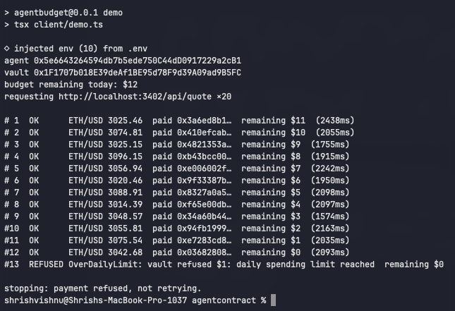

# AgentBudget

An on-chain spending policy for autonomous agents. The operator funds a vault
and sets per-call and per-day limits; the agent holds a key but no funds, and
every payment it makes is refused by the contract — not by client code — the
moment it would exceed policy.

> **Testnet only. Unaudited.** Deployed on Base Sepolia with a mock USDC. Do not
> point this at real funds.

## What it demonstrates



```
$ npm run demo
agent 0x5e6643264594db7b5ede750C44dD0917229a2cB1
vault 0x1F1707b018E39deAf1BE95d78F9d39A09ad9B5FC
budget remaining today: $12
requesting http://localhost:3402/api/quote ×20

# 1  OK      ETH/USD 3058.83  paid 0xddf62d13…  remaining $11  (1496ms)
# 2  OK      ETH/USD 3047.37  paid 0xc758e4e4…  remaining $10  (1719ms)
# 3  OK      ETH/USD 3061.08  paid 0xc68031dc…  remaining $9  (1955ms)
# 4  OK      ETH/USD 3020.43  paid 0x725c7455…  remaining $8  (2092ms)
# 5  OK      ETH/USD 3047.90  paid 0x9aadf3ad…  remaining $7  (2100ms)
# 6  OK      ETH/USD 3085.23  paid 0xf74c94ec…  remaining $6  (2098ms)
# 7  OK      ETH/USD 3071.08  paid 0x371aa3ba…  remaining $5  (2097ms)
# 8  OK      ETH/USD 3092.18  paid 0x9a1cb05f…  remaining $4  (1628ms)
# 9  OK      ETH/USD 3040.75  paid 0x0f776eab…  remaining $3  (2144ms)
#10  OK      ETH/USD 3075.82  paid 0x5737f2f3…  remaining $2  (1991ms)
#11  OK      ETH/USD 3094.17  paid 0xf48c4332…  remaining $1  (2098ms)
#12  OK      ETH/USD 3023.12  paid 0x37859d12…  remaining $0  (2106ms)
#13  REFUSED OverDailyLimit: vault refused $1: daily spending limit reached  remaining $0

stopping: payment refused, not retrying.
```

Policy: $1 per call, $12 per UTC day. Twenty requests are attempted; twelve are
paid and served; the thirteenth is refused by `AgentBudget.pay()` reverting with
`OverDailyLimit`. The client decodes the revert, prints it, and exits 0.

The refusal is the contract's, not the client's. `payingFetch` contains no limit
logic; it sends the transaction and reports what the chain said. On a run where
the RPC node lagged, request 13 was submitted anyway and reverted on-chain:
[`0x07b79fd1…`](https://sepolia.basescan.org/tx/0x07b79fd189d127bb48767b692c10336bb0ad43ebd8d4ae01e044b8064a36195c).

## Architecture

```
 operator (owner key)                              service provider
   │ setPolicy / setPayee / withdraw                   │
   ▼                                                   ▼
 ┌──────────────────────────┐   USDC   ┌───────────────────────────────┐
 │  AgentBudget (vault)     │─────────▶│  payee address                │
 │  holds USDC              │          └───────────────────────────────┘
 │  policies[agent]         │
 │  spends[agent] per day   │   Paid event      ┌────────────────────────┐
 │  usedRequestId[]         │──────────────────▶│  Hono paywall (server) │
 └──────────────────────────┘                   │  402 → offer           │
              ▲ pay(payee, amount, requestId)   │  verify receipt        │
              │                                 │  redeem once           │
 ┌──────────────────────────┐   HTTP + X-Payment-Tx   │  deny log         │
 │  agent (key only)        │◀───────────────────────▶│                    │
 │  payingFetch()           │                         └────────────────────┘
 └──────────────────────────┘
```

**Contract** (`contracts/src/AgentBudget.sol`) — holds the funds. Owner sets
`Policy { perCallMax, dailyMax, active }` per agent and an allowlist of payees.
An agent calls `pay(payee, amount, requestId)`; the contract checks, in order:
agent active → payee allowlisted → `requestId` unused → `amount ≤ perCallMax` →
`spentToday + amount ≤ dailyMax`. Each failure is a distinct custom error. The
daily counter is keyed by `block.timestamp / 1 days`, so it "resets" lazily at
the UTC boundary with no state write. Effects are recorded before the transfer.

**Paywall** (`server/paywall.ts`) — Hono middleware. An unpaid request gets a
402 with `{ price, payee, contract, requestId, expiresAt, chainId }`; the
`requestId` is random, bound to the request path, and held in memory. A retry
with `X-Payment-Tx: <hash>` is verified against the chain: tx succeeded → a
`Paid` log whose *emitting address is the vault* → payee matches → `requestId`
was issued for this path → not expired → amount covers price → hash not already
redeemed. Any failure logs one structured JSON denial line and returns 402.

**Client** (`client/payingFetch.ts`) — a `fetch` wrapper. On 402 it checks the
offer names *our* vault and chain, calls `pay()`, waits one confirmation, and
retries with the hash. A revert is decoded into a `PaymentRefused` error naming
the violated limit. It never retries a refused payment. Payment is a property of
the transport layer, not a tool any agent logic can invoke.

## Threat model

| Threat | Who | Mitigation | Where |
|---|---|---|---|
| Runaway loop burns the wallet | agent bug | `dailyMax` — bounded loss per UTC day | contract |
| Single oversized payment | agent bug / injection | `perCallMax` | contract |
| Prompt injection redirects payment to attacker | attacker via agent | payee allowlist; `PayeeNotAllowed` | contract |
| Agent key leaked | attacker | key holds no funds; capped at `dailyMax` to allowlisted payees; `revokeAgent` | contract |
| Agent bypasses limits by editing its own code | compromised agent | no limit logic exists client-side to bypass | contract |
| Receipt for `/cheap` presented to `/expensive` | dishonest agent | `requestId` bound to path at issuance | server |
| One receipt replayed for many responses | dishonest agent | in-memory redeemed set; contract also rejects duplicate `requestId` | server + contract |
| `Paid` event forged by a lookalike contract | anyone | only logs with `address == VAULT` are parsed | server |
| Stale / recycled offer | dishonest agent | `expiresAt` on each offer | server |
| Server lies about which vault to pay | compromised server | client refuses offers whose `contract`/`chainId` differ from its config | client |
| Reentrancy via malicious token | n/a for USDC, but | checks-effects-interactions; state written before `safeTransfer` | contract |

**Not mitigated in v0:** re-orgs after one confirmation (documented tradeoff);
paywall state loss on restart (in-process maps; P1 moves to Redis); an agent
that pays and then never presents the receipt (its own loss); operator key
compromise (that is the root of trust).

`scripts/attacks.ts` exercises the server-side rows against the live deployment:

```
$ npm run attacks
PASS  cross-path: /api/quote receipt on /api/premium -> 402 requestId was issued for a different path
PASS  correct path served once                       -> 200 ETH/USD
PASS  replay of redeemed receipt                     -> 402 payment already redeemed
PASS  real-vault tx with no Paid event               -> 402 no Paid event from vault in transaction
PASS  lookalike vault 0x679e7990… Paid event         -> 402 no Paid event from vault in transaction
PASS  malformed header                               -> 400 malformed payment header
PASS  unknown tx hash                                -> 402 transaction not found or not yet mined
```

## Design decisions

**Why is policy on-chain rather than in a database?** The enforcement point has
to be somewhere the agent's key cannot reach. A limit in Postgres is a limit
the agent's process can be tricked, bugged, or hacked into skipping; a limit in
the contract is one the key physically cannot exceed, because the key never
holds funds and the contract is the only path to them. If the agent's whole
machine is compromised, the attacker gets exactly `dailyMax` to allowlisted
addresses and nothing more.

**Why is payment in the transport layer rather than a tool?** If `pay` were a
tool, an LLM could be talked into calling it. As a `fetch` wrapper, the agent
has no concept of paying — it asks for URLs and either gets them or gets a
refusal. There is no surface for an injection to target.

**Why is denial logging off-chain?** A denied `pay()` is a revert; it leaves no
event and costs the agent gas only if it was actually submitted. The
interesting refusals for an operator (replays, cross-path, forged receipts)
never touch the chain at all. The server sees every attempt, so the server
logs. On-chain success (`Paid` events) is the audit trail for spend; off-chain
denial logs are the audit trail for abuse.

**Why one confirmation?** Base Sepolia has ~2s blocks and the amounts are cents.
Waiting for L1 finality (~minutes) would make the demo unusable for the
sub-second-API use case this is meant for. A re-org after one confirmation is
a real but tiny window; a production deployment would pick a depth per price
tier. v0 documents the choice rather than resolving it.

**Why a UTC day rather than a rolling 24h window?** One `uint64` day index and
one comparison. A rolling window needs a ring buffer of timestamps per agent
and a loop in `pay()`. UTC is less intuitive for operators — "my budget reset
at 5pm" — and is flagged for P1.

## Running it

Prerequisites: [Foundry](https://getfoundry.sh), Node 22+, Base Sepolia ETH on
two fresh keys (owner and agent — see `.env.example`).

```sh
npm install
cd contracts && forge test && cd ..        # 13 tests

cp .env.example .env                       # fill in keys and RPC
cd contracts && ./deploy.sh && cd ..       # deploys, funds vault, writes addresses to .env
npm run abi                                # regenerate shared/AgentBudget.abi.ts

npm run server                             # terminal 1
npm run demo                               # terminal 2 — the 20-request run above
npm run attacks                            # optional — adversarial cases
```

The demo consumes the agent's full daily budget. To run it again the same UTC
day, raise `dailyMax` by $12 with `setPolicy`, or wait for the day to roll.

## Layout

```
contracts/src/AgentBudget.sol    policy vault
contracts/src/MockUSDC.sol       6-decimal test token, public mint
contracts/test/AgentBudget.t.sol forge tests (one per PRD acceptance criterion + edges)
contracts/script/Deploy.s.sol    deploy + fund + policy + payee
contracts/deploy.sh              runs tests, broadcasts, writes addresses to .env
server/paywall.ts                402 middleware
server/index.ts                  two paid routes
client/payingFetch.ts            fetch that pays on 402
client/demo.ts                   the 20-request demo
scripts/attacks.ts               server-side adversarial checks
scripts/extract-abi.mjs          Foundry artifact → typed TS ABI
shared/                          config, viem clients, generated ABI
prd.md                           the spec this was built to
```

## Deployed (Base Sepolia, chain 84532)

| | |
|---|---|
| AgentBudget | [`0x1F1707b018E39deAf1BE95d78F9d39A09ad9B5FC`](https://sepolia.basescan.org/address/0x1F1707b018E39deAf1BE95d78F9d39A09ad9B5FC) |
| MockUSDC | [`0x63D3f0436d16A63A53A4936f67deB068752228d3`](https://sepolia.basescan.org/address/0x63D3f0436d16A63A53A4936f67deB068752228d3) |

## Not in scope (v0)

Mainnet, session keys / ERC-4337, x402 facilitator, multi-agent shared
budgets, a real LLM agent, a dashboard, persistent offer storage. See `prd.md`
for why each was cut and what P1/P2 look like.
